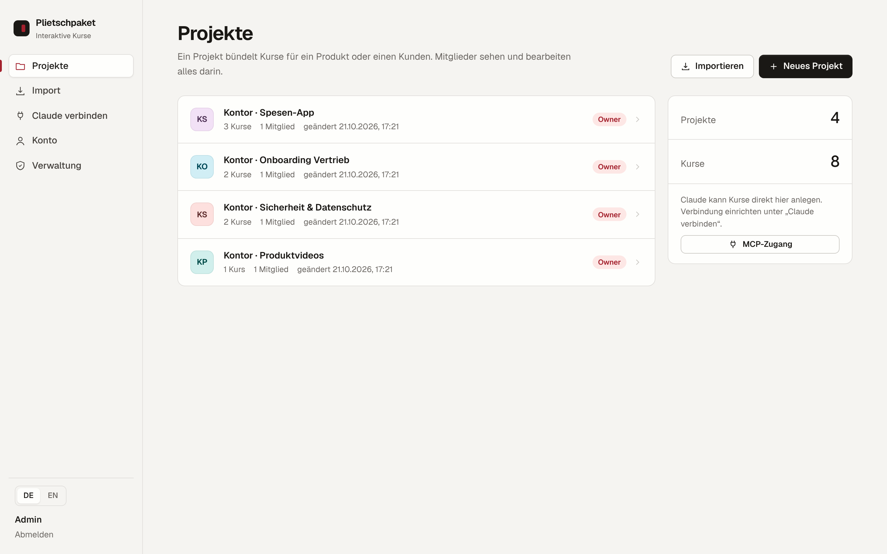

# Plietschpaket

*English version: [README.md](README.md) · Website: [tillheidrich.github.io/plietschpaket/de](https://tillheidrich.github.io/plietschpaket/de/)*

Plietschpaket ist ein Autorenwerkzeug im Browser für interaktive E-Learning-Kurse. Aus H5P-Inhalten entsteht ein
Paket für SCORM 1.2, SCORM 2004 oder HTML. Menschen arbeiten in der Oberfläche, KI-Assistenten wie Claude über MCP mit OAuth.
*Plietsch* ist Plattdeutsch und heißt schlau, aufgeweckt.



- **App-Simulation (eigener Inhaltstyp `H5P.AppSimulation`):** Software-Training auf Screenshots. Lernende tippen die richtige Stelle an (Navigation sonst gesperrt), Info-/Hinweis-Schritte, Erkunden-Schritte mit Hover-Erklärungen, Abschlussbildschirm, Punkte für „beim ersten Versuch gelöst“, Fortsetzen, Tastatur-Alternative. Ohne Ton; Video (Datei oder YouTube/Vimeo) optional davor. Klickbereiche zieht man im Editor direkt auf dem Screenshot auf.
- **Inhaltstypen:** 55 Typen, u. a. Interaktives Video (Pausen, Fragen, Buttons, Sprünge), Branching Scenario, Course Presentation, Quiz, Drag & Drop, Lückentext, Hotspots, Lernkarten.
- **Mehrbenutzer:** Admin legt Konten an; Projekte mit Rollen Owner / Editor / Viewer.
- **Sprachen:** Oberfläche Deutsch/Englisch; Kurse in DE, EN, FR, IT (inkl. Sprachfassung aus bestehendem Kurs).
- **Import:** `.h5p` (z. B. aus Lumi: Datei → Speichern), ZIP mit mehreren `.h5p`, Plietschpaket-Projekt-ZIP, Klick-Übungs-Pakete (`course.json` + Screenshots) → bearbeitbare App-Simulation.
- **Varianten:** Sprachfassung eines Kurses mit einem Klick (DE/EN/FR/IT, Oberflächentexte und Medien werden übernommen), danach Texte und Screenshots tauschen.
- **Export:** SCORM 1.2, SCORM 2004 4th Ed., HTML. Eingebauter LMS-Simulator zeigt, was ein LMS erhalten würde.
- **Lizenz:** GPL-3.0-or-later (wegen @lumieducation/h5p-server, GPL-3.0).

## Betrieb mit Docker

```bash
docker compose up -d --build
```

Die Anwendung lauscht auf Port **8080**. Davor gehört ein Reverse Proxy mit TLS (Traefik, nginx, Caddy …).
Alle Daten liegen im Volume **`/data`** (SQLite-Datenbank, H5P-Bibliotheken, Inhalte, Exporte).

### Umgebungsvariablen

| Variable | Pflicht | Bedeutung |
|---|---|---|
| `PUBLIC_URL` | ja | Externe URL inkl. `https://`, ohne Slash am Ende. Wird für OAuth/MCP gebraucht. |
| `ADMIN_EMAIL` / `ADMIN_PASSWORD` | beim ersten Start | Legt das erste Admin-Konto an, solange noch keins existiert (Passwort ≥ 10 Zeichen). |
| `APP_SECRET` | empfohlen | Langer Zufallswert zum Signieren von Download-Links. Ohne Angabe wird `/data/app-secret.key` erzeugt. |
| `PORT` | nein | Standard 8080. |
| `UI_LANGUAGE` | nein | Standardsprache des H5P-Editors (`de`/`en`). |
| `LIBRARY_INSTALL` | nein | Wer neue H5P-Inhaltstypen über `.h5p`-Import installieren darf: `admin` (Standard) oder `all`. Inhaltstypen enthalten JavaScript, das im Browser aller Nutzer läuft. Nur vertrauenswürdige Pakete installieren. |
| `ALLOW_HUB` | nein | `true` erlaubt das Nachladen von Inhaltstypen aus dem H5P-Hub (ausgehende Verbindung zu h5p.org). Standard `false`. |
| `MAX_UPLOAD_MB` | nein | Maximale Uploadgröße, Standard 512. Reverse Proxy entsprechend einstellen. |
| `SESSION_DAYS` | nein | Laufzeit der Browser-Sitzung, Standard 14. |
| `TRUST_PROXY` | nein | Anzahl Reverse-Proxys vor dem Container (Standard 1). Nötig für echte Client-IPs und Rate-Limits. Den Container-Port nie direkt veröffentlichen. |
| `OAUTH_REDIRECT_HOSTS` | nein | Erlaubte OAuth-Rückleitungen (Standard `claude.ai,claude.com`, plus localhost). |
| `MAX_PARALLEL_JOBS` | nein | Gleichzeitige Exporte/Importe (Standard 3, je Person 1). |
| `KEEP_EXPORTS_PER_COURSE` | nein | Aufbewahrte Export-Pakete je Kurs (Standard 20; ältere werden stündlich gelöscht). |
| `AUDIT_RETENTION_DAYS` | nein | Aufbewahrung des Audit-Logs (Standard 365). |
| `MCP_UPLOAD_MB` | nein | Größte Datei für das MCP-Werkzeug `upload_asset` bzw. `upload_local_file` der Desktop-Erweiterung (Standard 100). |

Im Produktionsbetrieb (`NODE_ENV=production`, Standard im Image) startet der Container nicht ohne `PUBLIC_URL` und nicht mit einem Platzhalter-Passwort aus der Vorlage.

### Backup

Das Volume `/data` sichern (bei laufendem Container ist die SQLite-Datei im WAL-Modus; sauberer ist ein kurzer Stopp
oder `sqlite3 /data/plietschpaket.sqlite ".backup /data/backup.sqlite"`). Projekte lassen sich zusätzlich in der
Oberfläche als ZIP exportieren und wieder importieren.

### Health-Check

`GET /healthz` → `{"status":"ok"}`

Für einen ersten Test eines der Pakete aus [`examples/`](examples/) importieren.

## Claude verbinden (MCP)

**Weg A: Konnektor (Server ist aus dem Internet erreichbar):**
1. In Claude: Einstellungen → Connectors → Eigenen Connector hinzufügen.
2. URL: `https://<PUBLIC_URL>/mcp`
3. Claude leitet zur Anmeldung von Plietschpaket weiter; dort zustimmen. Fertig.

**Weg B: Claude Desktop lokal (Server nur im Firmennetz/VPN):** Konnektoren werden aus der Anthropic-Cloud aufgebaut
und erreichen interne Server nicht. Dafür gibt es eine Desktop-Erweiterung, die auf dem Rechner der Person läuft:
1. In Plietschpaket unter **Claude verbinden** die Erweiterung `plietschpaket.mcpb` herunterladen (Adresse der Instanz ist
   bereits eingetragen) und doppelklicken bzw. in Claude Desktop unter Einstellungen → Erweiterungen installieren.
2. Auf derselben Seite einen persönlichen **Zugangsschlüssel** erzeugen (Passwort-Bestätigung, 30 oder 90 Tage) und in der
   Erweiterung einfügen. Bei firmeneigener Zertifizierungsstelle die PEM-Datei im Feld „Internes Stammzertifikat“ wählen.
3. Ohne Erweiterung geht es auch manuell (`claude_desktop_config.json`, Node.js ≥ 18), Vorlage auf derselben Seite.

Die Erweiterung bringt zusätzlich das lokale Werkzeug `upload_local_file`: Claude lädt Screenshots und Videos direkt vom
Rechner hoch (nur Bild-, Video-, Audio- und `.vtt`-Dateien, max. 100 MB), statt sie durch den Chat zu kopieren.

Zugangsschlüssel werden nur gehasht gespeichert, sind widerrufbar und verfallen bei Passwortwechsel, Passwort-Reset und
Deaktivierung automatisch. Quellcode der Brücke: `desktop-extension/` (ohne Abhängigkeiten, nur Node-Bordmittel).

Die App ist selbst OAuth-2.1-Autorisierungsserver (Dynamic Client Registration, PKCE S256, Refresh-Token-Rotation).
Verbundene Clients sieht und widerruft jede Person unter **Konto → Verbindungen**. Die KI arbeitet immer mit den Rechten
der angemeldeten Person.

Wichtige Tools: `get_authoring_guide`, `create_course`, `get_content_schema`, `create_unit`, `upload_asset` (nur Base64,
max. 25 MB, Inhaltsprüfung), `create_language_version`, `export_course`.

## Sicherheit

Schutzbedarfsklasse, Bedrohungsskizze, Abnahmetests und bewusste Ausnahmen: siehe [`SECURITY.md`](SECURITY.md).
Prüfungen: `node test/security.mjs` (IDOR-Matrix, Token-Widerruf, OAuth, Header), CI in `.github/workflows/ci.yml` (Gitea-Variante unter `.gitea/`).

## Entwicklung

```bash
npm ci
node scripts/build-vendor.mjs
DATA_DIR=./data ADMIN_EMAIL=admin@example.com ADMIN_PASSWORD=adminpass1234 PORT=8099 npm start
# Tests gegen laufende Instanz
BASE=http://localhost:8099 node test/smoke.mjs
BASE=http://localhost:8099 DATA_DIR=./data node test/security.mjs
BASE=http://localhost:8099 node test/appsim.mjs
VIDEO=clip.webm node test/interactive-video.mjs
```

## Grenzen

- SCORM-Pakete fremder Tools können nicht zurück in bearbeitbare Inhalte verwandelt werden (nur `.h5p` und eigene Projekte).
- SCORM 1.2 speichert max. 4096 Zeichen Fortschritt. Bei langen interaktiven Videos SCORM 2004 wählen.
- Videos am besten als MP4 (H.264) hochladen.
