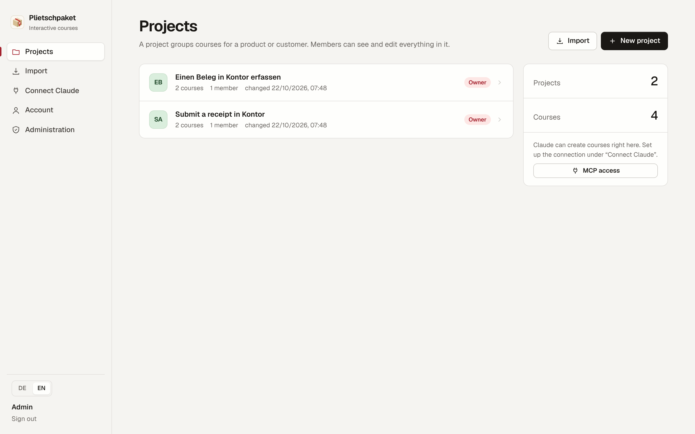
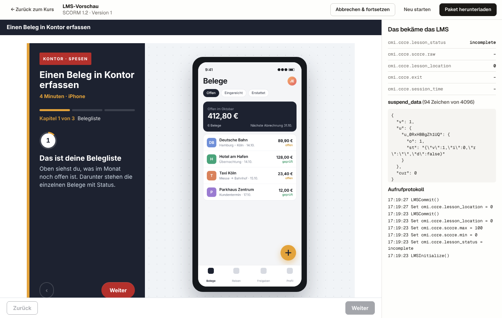
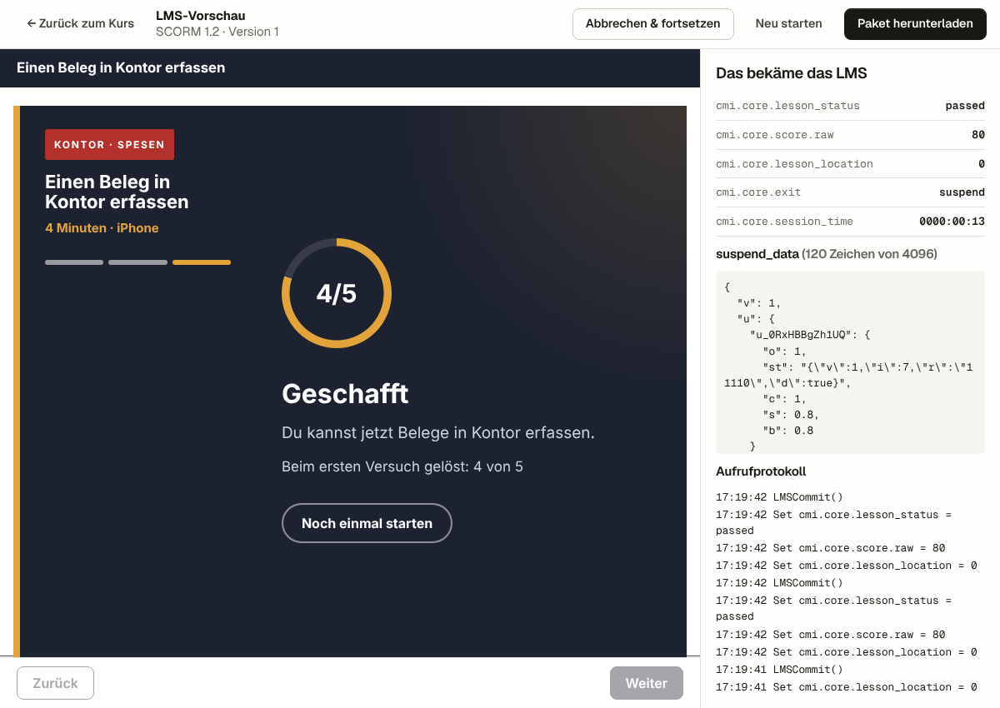
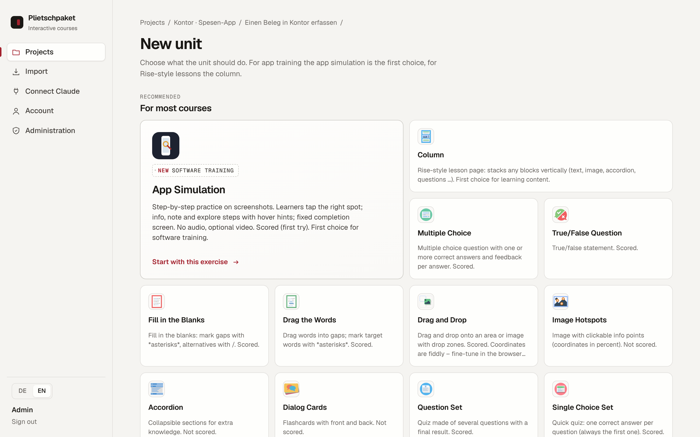
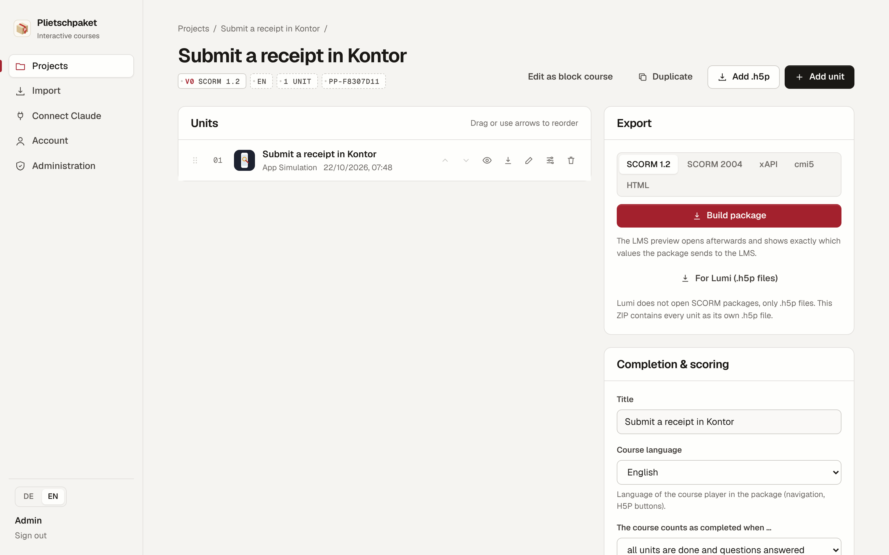
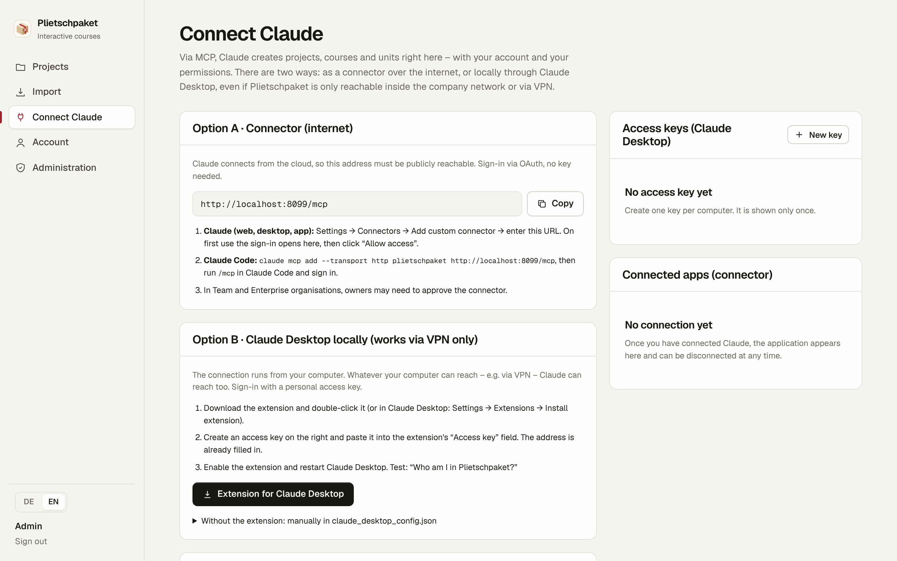

# Plietschpaket

*Deutsche Fassung: [README.de.md](README.de.md) · Website: [plietschpaket.heidrich-digital.de](https://plietschpaket.heidrich-digital.de/)*

Plietschpaket is a self-hosted authoring tool for interactive e-learning. You build courses from H5P content in the
browser, or you let Claude build them for you over MCP, and you get a SCORM 1.2, SCORM 2004 or HTML package that any
LMS can import.

The name is Low German. *Plietsch* (say "pleetch") means clever, so a *Plietschpaket* is a clever package.



## What it does

Plietschpaket was built for software training. A typical course starts with a short product video and then lets
people practise the same steps on screenshots of the real app. They tap where they would tap in the app, get a hint
after two misses and a score for what they solved on the first try. The LMS receives completion, score and resume
data like it would from any commercial authoring tool.

| App simulation in the built-in LMS preview | Completion screen |
|---|---|
|  |  |

The app simulation is a content type of its own (`H5P.AppSimulation`). You drag the click areas directly onto the
screenshot in the editor. Besides tap tasks it has info steps, notes and explore steps with hover hints, plus an
optional video (file, YouTube or Vimeo) in front. Keyboard users get an alternative to tapping.

Next to it you get the 55 H5P content types the bundle ships with. Interactive video is the one most people ask for:
buttons on the video, questions that pause playback, jumps between chapters. There are also branching scenarios,
course presentations, quizzes, drag and drop, fill in the blanks, hotspots and flashcards.



Other things that matter in day-to-day work:

- Several people work on shared projects. An admin creates the accounts, and each project has owners, editors and viewers.
- The interface is in German and English. Courses can be exported in German, English, French or Italian, and one click
  turns an existing course into a new language version that keeps all media.
- Import takes `.h5p` files (from Lumi, for example), ZIP files with several of them, Plietschpaket project exports and
  "click practice" packages (`course.json` plus screenshots), which become editable app simulations.
- Every export opens in an LMS simulator that shows exactly which SCORM values the package sends.



## Building courses with Claude

Plietschpaket is its own OAuth 2.1 authorization server and speaks MCP over Streamable HTTP. Claude can create
projects, look up the schema of a content type, write units, upload media, make language versions and export the
package. It always acts with the rights of the person who signed in.

There are two ways to connect, and the **Connect Claude** page in the app walks you through both:

1. **Connector.** If the server is reachable from the internet, add `https://<your-host>/mcp` as a custom connector in
   Claude. Claude sends you to the Plietschpaket sign-in, you confirm, done.
2. **Claude Desktop extension.** Connectors are opened from Anthropic's cloud, so they cannot reach a server that only
   lives inside a company network or VPN. For that case the app offers a `plietschpaket.mcpb` desktop extension with
   your server address already filled in. It runs on your own machine and talks to the server with a personal access
   key that you create on the same page. The extension also adds a local `upload_local_file` tool, so Claude can send
   screenshots and videos straight from your disk instead of pasting them through the chat.



Access keys are stored hashed, expire after 30 or 90 days and stop working when the password changes or the account
is deactivated. The bridge in `desktop-extension/` has no dependencies and uses only Node built-ins.

## Running it

You need Docker and a reverse proxy that terminates TLS (Traefik, nginx, Caddy or whatever you already use).

```bash
cp .env.example .env        # set ADMIN_PASSWORD and APP_SECRET
# edit PUBLIC_URL and ADMIN_EMAIL in docker-compose.yml
docker compose up -d --build
```

The container listens on port 8080 and keeps everything (SQLite database, H5P libraries, content, exports) in the
`/data` volume. In production it refuses to start without `PUBLIC_URL` or with the placeholder password from the template.
`GET /healthz` returns `{"status":"ok"}`. For a first test, import one of the packages in [`examples/`](examples/).

| Variable | Required | Meaning |
|---|---|---|
| `PUBLIC_URL` | yes | External URL including `https://`, no trailing slash. OAuth and MCP depend on it. |
| `ADMIN_EMAIL`, `ADMIN_PASSWORD` | first start | Creates the first admin while no account exists (password with 10 or more characters). |
| `APP_SECRET` | recommended | Long random value for signing download links. Without it the app writes `/data/app-secret.key`. |
| `TRUST_PROXY` | no | Number of reverse proxies in front of the container (default 1). Needed for real client IPs and rate limits. |
| `LIBRARY_INSTALL` | no | Who may install new H5P content types through `.h5p` import: `admin` (default) or `all`. Content types contain JavaScript that runs in every user's browser. |
| `ALLOW_HUB` | no | `true` allows downloads from the H5P Hub (outgoing connection to h5p.org). Default `false`. |
| `MAX_UPLOAD_MB` | no | Largest upload, default 512. Set your proxy to match. |
| `OAUTH_REDIRECT_HOSTS` | no | Allowed OAuth callback hosts. Default `claude.ai,claude.com`, plus localhost. |
| `MCP_UPLOAD_MB` | no | Largest file for the MCP upload tools, default 100. |

The German README lists the remaining options (session length, job limits, retention of exports and audit log).

For backups, save the `/data` volume. The database runs in WAL mode, so either stop the container briefly or use
`sqlite3 /data/plietschpaket.sqlite ".backup /data/backup.sqlite"`. Projects can also be exported as ZIP files from the UI.

## Development

```bash
npm ci
node scripts/build-vendor.mjs
DATA_DIR=./data ADMIN_EMAIL=admin@example.com ADMIN_PASSWORD=adminpass1234 PORT=8099 PUBLIC_URL=http://localhost:8099 npm start

# tests run against the running instance
BASE=http://localhost:8099 node test/smoke.mjs
BASE=http://localhost:8099 DATA_DIR=./data node test/security.mjs
BASE=http://localhost:8099 node test/appsim.mjs
VIDEO=clip.webm node test/interactive-video.mjs
```

The stack is Node 22, Express 5 and better-sqlite3, with the H5P server from [Lumi](https://github.com/Lumieducation/H5P-Nodejs-library).
The web app is plain JavaScript without a build step. The SCORM runtime in `src/export/runtime/` is our own.

## Security

The threat model, acceptance tests and the deliberate exceptions are in [SECURITY.md](SECURITY.md) (German).
Please report vulnerabilities through GitHub Security Advisories, not through public issues.

## Limits

- SCORM packages from other tools cannot be turned back into editable content. Import works for `.h5p` files and Plietschpaket projects.
- SCORM 1.2 stores at most 4096 characters of progress. Use SCORM 2004 for long interactive videos.
- Upload videos as MP4 (H.264) if you can. Some browsers in LMS environments do not play WebM.

## License

GPL-3.0-or-later, because the bundled `@lumieducation/h5p-server` is GPL-3.0. The H5P content types keep their own
licenses (mostly MIT). "H5P" is a trademark of H5P Group AS; this project is not affiliated with them.
