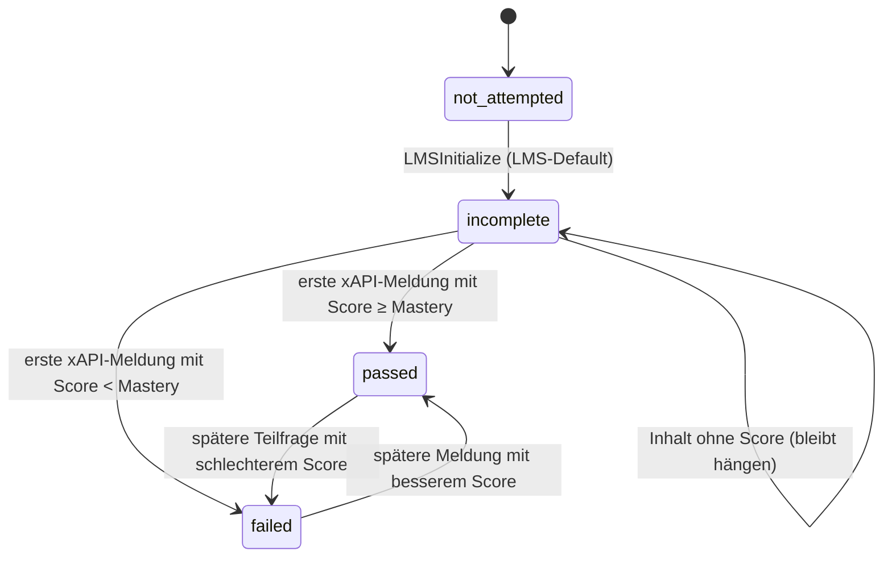

# Lumi Desktop – SCORM-Export (Reverse Engineering)

Stand: 21.10.2026 · Analysierte Version: Lumi Desktop **1.0.3** (Commit vom 07.05.2026, Lizenz AGPL-3.0) mit `@lumieducation/h5p-server` / `h5p-html-exporter` **9.3.3** und `simple-scorm-packager` **0.2.7**. Quelle: github.com/Lumieducation/Lumi.
Zweck dieses Dokuments: verstehen, was Lumi beim Export *tatsächlich* tut, damit unser eigener Builder die guten Teile übernimmt und die Schwachstellen bewusst anders löst. Kein Lumi-Code wird übernommen (AGPL), nur das Verhalten dokumentiert.

## 1. Business Purpose
Ein einzelner H5P-Inhalt (z. B. ein Quiz, eine Course Presentation, ein Interactive Book) wird als SCORM-1.2-ZIP gespeichert, das in ein LMS hochgeladen werden kann und dort Punktzahl und Abschluss meldet.

## 2. Actors
- **Autorin/Autor** in Lumi Desktop (löst Export über Menü/Dialog aus)
- **LMS** (empfängt das Paket, liefert die SCORM-API zur Laufzeit)
- **Lernende** (spielen das Paket im LMS ab; ihre H5P-Ereignisse erzeugen die Meldungen)

## 3. Preconditions
- Inhalt ist in Lumi geöffnet und gespeichert (es gibt eine `contentId`).
- Die benötigten H5P-Bibliotheken liegen lokal vor (Lumi bringt 144 Bibliotheks-Ordner mit, darunter ~75 Inhaltstypen).
- Nutzer wählt im Speichern-Dialog einen Zielpfad mit Endung `.zip`; ohne Pfad bricht der Ablauf still ab.

## 4. Main Flow
1. Export wird angefordert, Zielpfad per Dialog bestimmt (`events/websocket/export_as_scorm.ts`).
2. Oberfläche zeigt Ladezustand.
3. Export-Optionen werden mit festen Vorgaben gemischt: Ränder 0, Mastery Score 0, keine Lizenz-/Einbettungs-Buttons, Oberflächensprache fest **„en“** (`ops/content_export_as_scorm.ts` Z. 22–42).
4. Ein HTML-Bündel des Inhalts wird erzeugt (alle Skripte/Styles inline, Mediendateien extern) und mit SCORM-Template versehen (`ops/templates/scorm.ts`).
5. Zwei Laufzeitdateien kommen dazu: `SCORM_API_wrapper.js` (pipwerks, MIT) und `h5p-adaptor.js` (Lumi) (`ops/export-h5p.ts` Z. 39–46).
6. Mediendateien werden einzeln in ein Temp-Verzeichnis kopiert (Z. 61–79).
7. Manifest wird erzeugt: SCORM **1.2**, Titel und Autor aus den Metadaten, Kennung **fest „00“**, Mastery Score aus Option (Z. 86–105).
8. ZIP wird gepackt und umbenannt; Erfolgsmeldung.

## 5. Decision Rules
| Regel | Quelle |
|---|---|
| Exportformat ist immer SCORM 1.2 (2004 ist im Adaptor vorbereitet, wird aber nie gepackt) | `export-h5p.ts` Z. 88 |
| Paketkennung ist für **jedes** Paket „00“ (überschreibt die vom Packager generierte GUID) | Z. 95; `simple-scorm-packager/lib/schemas/scorm12.js` Z. 7–12 |
| Fehlt ein Autor, steht der unübersetzte Schlüssel `editor.exportDialog.defaults.authorName` als Organisation im Manifest | Z. 89–92 |
| Jede xAPI-Meldung **mit Ergebnis** – auch von Teilfragen – schreibt Punktzahl und Status neu | `h5p-adaptor.js` Z. 68–72 |
| Meldung ohne Punktzahl wird ignoriert → reine Inhalte (Akkordeon, Video ohne Fragen, Buch ohne Quiz) melden **nie** „completed“ | Z. 27–30 |
| SCORM 1.2 mit Mastery Score: Status „passed“/„failed“; ohne gelieferten Wert ergibt `"" / 100 = 0` → praktisch immer „passed“ | Z. 35–36, 55–61 |
| Es werden keine `cmi.interactions`, kein `suspend_data`, kein `lesson_location` geschrieben → kein Wiedereinstieg, keine Einzelfrage-Auswertung im LMS | ganzer Adaptor; `HtmlExporter.ts` Z. 848 (`contentUserData: ''`) |
| Ein Paket = genau ein H5P-Inhalt; Kurse aus mehreren Einheiten gibt es nicht (Workaround: Interactive Book / Course Presentation) | `exportScorm()` Signatur |

## 6. State Transitions (LMS-Sicht, SCORM 1.2)

Kernproblem: Der Status kann während eines Quiz mehrfach kippen, weil jede Teilfrage ihren eigenen Score meldet. Welcher Wert am Ende steht, hängt von der Reihenfolge der Meldungen ab. **Im SCORM Cloud / Moodle zu verifizieren** (Annahme aus Code, nicht getestet).

## 7. Billing / Credit Impact
Keine Kosten im Spiel. Analogie für LMS-Reporting: Punktzahl wird als `score.raw` = skaliert × 100 geschrieben; zusätzlich wird `cmi.core.score.scaled` gesetzt, das es in SCORM 1.2 nicht gibt (LMS lehnt ab, Fehler wird verschluckt).

## 8. Exceptions / Edge Cases
- Kein Zielpfad → Abbruch ohne Meldung.
- Umbenennen schlägt fehl → `fsExtra.remove(temporaryFilename)` mit relativem Pfad; Temp-Datei bleibt ggf. liegen, keine Fehlermeldung (Z. 114–121).
- `get()` im Adaptor gibt nichts zurück (fehlendes `return`) – derzeit ungenutzt, aber Falle für Erweiterungen.
- `window.onunload` für `LMSFinish` ist in modernen Browsern unzuverlässig (bfcache, Mobile) → Daten gehen verloren, wenn der Tab geschlossen wird.
- Oberflächensprache „en“ fest: H5P-Kernbeschriftungen erscheinen englisch, auch bei deutschen Inhalten.

## 9. Data Written / Read
- Gelesen: H5P-Parameter, Bibliotheken, Mediendateien, Metadaten (Titel, Autor, Sprache).
- Geschrieben: `index.html`, Mediendateien, `SCORM_API_wrapper.js`, `h5p-adaptor.js`, `imsmanifest.xml` (+ Schema-Dateien), ZIP.
- LMS: `cmi.core.lesson_status`, `cmi.core.score.raw/min/max` (+ ungültiges `score.scaled`).

## 10. Ambiguities / Questions
- Wie verhalten sich gängige LMS (Moodle, Cornerstone, SAP SuccessFactors, Docebo) bei identischer Manifest-Kennung „00“ über mehrere Kurse? Moodle vermutlich unkritisch, Systeme mit Kurs-Registry potenziell nicht.
- Welches LMS nutzt die Organisation bzw. ihre Kunden? Davon hängt ab, ob SCORM 1.2 reicht oder 2004/cmi5 nötig ist.
- Lumi Cloud (SaaS) hat evtl. einen anderen Exporter – nicht geprüft, Code nicht öffentlich.

## 11. Code References
- `Lumi/src/events/websocket/export_as_scorm.ts` (Auslöser, Dialog)
- `Lumi/src/ops/content_export_as_scorm.ts` Z. 22–42 (Vorgaben, Sprache „en“)
- `Lumi/src/ops/export-h5p.ts` Z. 28–128 (Bündeln, Manifest, ZIP)
- `Lumi/src/ops/templates/scorm.ts` (HTML-Hülle)
- `Lumi/assets/scorm-client/h5p-adaptor.js` Z. 1–72 (Laufzeitlogik)
- `H5P-Nodejs-library/packages/h5p-html-exporter/src/HtmlExporter.ts` Z. 848 (kein Nutzerzustand; geprüft in v10.0.4, Lumi nutzt 9.3.3)
- `simple-scorm-packager@0.2.7/lib/schemas/scorm12.js` Z. 3–16 (Kennung)

## Konsequenzen für unseren Builder
1. Eigener Laufzeit-Adapter: nur die **Top-Level-Meldung** (ohne `context.contextActivities.parent`) zählt für Score/Status.
2. Abschlussregel pro Einheit wählbar: *Punktzahl*, *gesehen*, *Fortschritt ≥ x %*.
3. Wiedereinstieg über H5P-`previousState` → `cmi.suspend_data` (1.2: 4.096 Zeichen Limit beachten, 2004: 64.000).
4. Eindeutige Kennung je Paket (UUID, stabil über Versionen desselben Kurses).
5. SCORM 1.2 **und** 2004 4th Ed.; optional `cmi.interactions` für Einzelfragen.
6. `pagehide`/`visibilitychange` statt `onunload`; Commit nach jeder bewerteten Meldung.
7. Oberflächensprache aus Kurssprache, nicht fest.
8. Mehrere Einheiten pro Kurs mit eigener Navigation.
